<p align="center">
  <picture>
    <source media="(prefers-color-scheme: dark)" srcset="docs/assets/brand/clusia-mark-dark.svg">
    
  </picture>
</p>

<h1 align="center">Clúsia</h1>
<p align="center"><b>PR Reviews for Humans</b></p>

Clúsia is a macOS app for reviewing pull requests carefully, with your own AI tools at your side. It is free and open source.

- **A review you control.** Open a pull request in a local worktree. Write comments on the diff and keep them as a draft that follows the code when the author pushes again. Publish everything as one GitHub review when you are ready.
- **Your harness, your models.** Claude Code, Codex or a command of your own helps with diagrams, security notes, audits and tests (coming in the next sub-projects). Nothing is sent anywhere you did not choose.
- **Always at hand.** A menu bar popover shows what is waiting for you, which saved reviews went stale and how your review activity looks over the last weeks.

> **Status:** the daemon, the GitHub sync, the review engine, the CLI, the menu bar tray, the main window, notifications and the one-command install work today. The agent and the harness come next. Progress is tracked on the [project board](https://github.com/users/rzorzal/projects/1).

## Install

```sh
curl -fsSL https://raw.githubusercontent.com/rzorzal/clusia/main/install.sh | bash
```

The script:

- builds Clúsia with [Homebrew](https://brew.sh) when you have it, and otherwise directly with Rust (installing the Xcode command line tools and Rust first if they are missing);
- runs `clusia install`, which puts **Clusia.app** in `/Applications` (or `~/Applications`), registers the background service to start at login, and links `clusia` into `/usr/local/bin` (or `~/.local/bin`);
- opens the app.

**Requirements:** macOS on Apple silicon or Intel, about 5 minutes and about 2 GB of free disk for the first build. Homebrew is optional. The script never uses `sudo`.

**Updating:** run the same command again. It replaces the app and keeps your settings and the notification permission.

| Option | Environment | What it does |
|---|---|---|
| `--dry-run` | `CLUSIA_DRY_RUN` | Prints every step and changes nothing |
| `--no-brew` | `CLUSIA_NO_BREW` | Builds directly even when Homebrew is installed |
| `--no-open` | `CLUSIA_NO_OPEN` | Does not open the app at the end |
| `--ref REF` | `CLUSIA_REF` | Installs a branch or tag instead of `main` |

Through the pipe, pass options after `bash -s --`:

```sh
curl -fsSL https://raw.githubusercontent.com/rzorzal/clusia/main/install.sh | bash -s -- --no-brew
```

**Homebrew by hand**, the same two steps the script runs:

```sh
brew install --HEAD rzorzal/clusia/clusia
clusia install --from "$(brew --prefix clusia)/libexec/bin"
```

**Read the script first:**

```sh
curl -fsSL https://raw.githubusercontent.com/rzorzal/clusia/main/install.sh -o install.sh
less install.sh
bash install.sh
```

**From a clone** of this repository (you need Git and the Rust toolchain pinned in `rust-toolchain.toml`):

```sh
cargo run --release -p clusia -- install
```

`clusia install --dry-run` shows what it would do.

## First steps

1. Open **Clusia.app**. The menu bar tray, the background service and the window come up. A few seconds later macOS asks to allow notifications; choose **Allow**.
2. Sign in to GitHub: the window uses your `gh` login, or run `clusia auth login` and give it a personal access token on stdin.
3. On a new machine the window opens on a short first run: connect GitHub, point Clúsia at the folders with your clones, and see which AI harness is installed. Press **Continue**.
4. Open a pull request from the tray, from Home, or with `clusia open owner/repo#123`.
5. Click a line to comment (Shift-click for a range) and reply to or resolve threads. Comments are rich text, with a toolbar, emoji, GIFs (add a Giphy key in Config › Media) and a preview of what GitHub will show.
6. Press **Finalize review**. Everything goes to GitHub as one review; nothing is posted before that. Closing a tab or the window with an unpublished draft asks first.

<p align="center">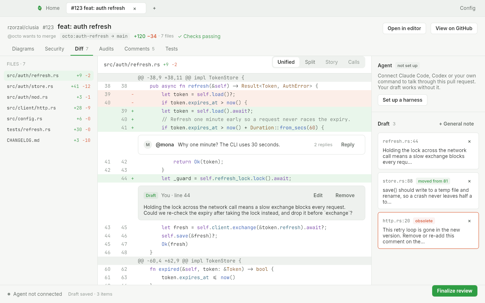</p>

<p align="center">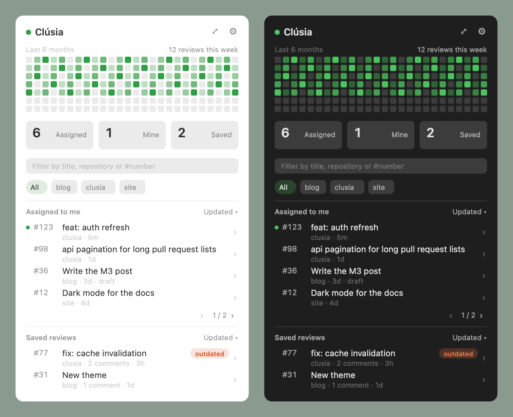</p>

## Everyday commands

Commands that talk to the daemon start it when it is not running; `daemon status`, `daemon stop`, `install` and `uninstall` do not. `clusia --help` lists the rest (`sync`, `worktree`, `activity`, `review status|note|edit|rm|close|discard`). Add `--json` for machine-readable output.

| Command | What it does |
|---|---|
| `clusia auth status` / `login` / `logout` | Show which token is used, store one in the Keychain (read from stdin), or remove it |
| `clusia prs [--assigned] [--mine]` | List pull requests where your review is requested and the ones you opened |
| `clusia open owner/repo#123` | Refresh, prepare the worktree and show what is new (a pull request URL works too) |
| `clusia review comment owner/repo#123 src/lib.rs:42 "text"` | Add a line comment (`path:line` or `path:start-end`) to the draft |
| `clusia review publish owner/repo#123 --verdict approve` | Publish the draft as one review (`approve`, `request-changes`, `comment` or `close`) |
| `clusia ask owner/repo#123 "Is the lock needed?"` | Ask the review's agent; the answer streams, and suggested comments are listed at the end (`file:line  text`). Ctrl-C only detaches: the turn keeps running in the daemon, and `clusia agent stop owner/repo#123` stops it. When the agent needs permission, a terminal asks `[o]nce / [r]eview / [d]eny` (Enter denies; anything typed in the first 300 ms after the question appears is ignored and the question is asked again, so a key aimed at something else never answers it). Ctrl-C at the question only detaches, like anywhere else: the request keeps waiting for the window and is denied when its time ends; without a terminal the request waits for the window or the notification |
| `clusia check owner/repo#123 [--security\|--audit]` | Run the security check, the audit or both on a review and print the findings as `HIGH  client/http.rs:52  title` (grouped by area for the audit). The exit code is 0 when the run finished, even with findings |
| `clusia diagrams owner/repo#123 [--draw]` | List the diagrams of the latest version of a review, one line each as `key  kind  title  state`, then who drew it and from which commit (and a line when the pull request has new commits since). `--draw` asks your agent to plan and draw them and follows the progress on stderr; Ctrl-C stops it, and the exit code is 1 when a diagram failed. With `--json` it prints `{"version": …, "stale": …}`. The 3D entry is listed as `keywords` with `ready · N families · M places` (singular for one), and `--json` includes its map. |
| `clusia story owner/repo#123 [--write]` | List the steps of a review's Story, one line each, then `Written by <agent> from commit <sha7>` or `Static order` (the order Clúsia works out itself, callees first, before an agent has written anything). `--write` asks your agent to write it and follows the progress on stderr; Ctrl-C stops it. With `--json` it prints the Story, its versions and the head of the pull request. |
| `clusia calls owner/repo#123 [function] [--depth N]` | Print the call graph of a changed function (the first changed one when none is named) level by level, as `↑3  auth_middleware  not touched`, then `●  TokenStore::refresh`, then `↓1  …`; depth 1 to 5, default from `diff.calls_depth`. With `--json` it prints the graph. |
| `clusia revalidate owner/repo#123 [--again]` | Check the draft comments of a saved review against its new commits now and print one line per comment (a round that already finished is printed as it is; `--again` runs it once more): `KEPT`, `MOVED`, `OBSOLETE`, `REWORD` or `NOT CHECKED`, then `file:line` and the text. Nothing in the draft changes: you decide in the window. The exit code is 0 when the round finished |
| `clusia tests owner/repo#123 [--generate] [--setup [--yes]] [--list] [--run [--all\|--near\|--one NAME]]` | The tests of a review. Alone it prints the environment (`Docker · Colima · running`, or `No container engine · local sandbox`), where the setup stands and the last run. `--generate` asks your agent for the recipe (one turn); `--setup` shows the plan with every command and asks before anything runs; `--list` lists the tests; `--run` runs them all, the ones near the change or one, printing `PASS  name  12 ms` per test and ending with `3 passed, 1 failed, 0 skipped in 4.2 s (container · Colima)`. The exit code is the run's: 0 when every test passed, the test command's own code when one failed, 124 when it ran past its limit, 130 when you stopped it. Ctrl-C stops the run |
| `clusia agent log owner/repo#123` / `agent stop owner/repo#123` | Replay the chat of a review, or stop the turn the agent is running |
| `clusia config get <key>` / `set <key> <value>` | Read or change one setting, for example `github.poll_interval_secs` |
| `clusia daemon status` / `stop` | Show whether the daemon runs, or stop it |
| `clusia install` / `uninstall` | Put the app, the login agent and the `clusia` link in place, or remove them |

## Agent

Clúsia can talk to **your own Claude Code, Codex or a command of your own** about the pull request you are reviewing. Install one and sign in (run `claude` once in a terminal, or `codex login`; a custom command signs in however it likes); Config › Harness shows where Clúsia found it, lets you pick which one to use, and tests it.

- **A chat per review.** Open the **Agent** tab in the right column of the review (⌘\ hides the column; the **Draft** tab is one click away). When you open a review, the agent starts a session and writes a summary; ask it anything after that. The session belongs to the review: close the window and open the review again and the conversation goes on. Publishing or discarding the review ends the session; the chat log stays in the data folder.
- **It reads, you decide.** The agent reads and searches the review's worktree. When it wants to do anything else (run a command, edit or write a file) Clúsia asks you with a **modal** that shows the exact command or path, the reason the agent gave, where it runs and a countdown: **Deny**, **Allow `cargo test …` for this review** (every command that starts with `cargo test`, nothing wider) or **Allow once**. Esc denies; Enter allows once. If you are not looking at the window, a notification (it ignores Do not disturb, because the request expires) opens it on the question, and `clusia ask` asks at the terminal. **No answer means deny**: after the time in Config › Harness (2 minutes by default) the request is denied and the chat says so, and so is everything pending when you press Stop, the turn ends, or you publish, discard or quit. With the sandbox on (the default), the agent cannot write outside the review's worktree, and a request that points outside it is refused without asking. What you allowed for the review is listed under **Allowed for this review** in the chat footer; the **×** takes a rule back, and the rules end with the review. If you also allow what your Claude Code settings already allow (a switch in Config › Harness, on by default), those rules apply, and your own `deny` rules still win. Clúsia never passes a bypass flag, never gives the agent your GitHub token, and turns your Claude Code hooks off for these turns. The agent never writes to git or GitHub; only you publish.
- **What "for this review" can cover.** Only one simple command at a time (no `;`, `|`, `&&`, redirects or substitutions) from a short list of build, test, format and read-only git commands, each with its subcommand: for example `cargo test`, `cargo build`, `npm test`, `go test`, `pytest`, `git status`, `git diff`, `git add`, `mkdir` and `touch`. Anything else gets **Allow once** only, and so does a command whose arguments point outside the worktree. File tools (edit, write) can be allowed for paths inside the worktree.
- **The limits.** A build or a test runs the repository's own code, and the agent may have edited that code, so allowing `cargo test` for a review lets that code run. The check on a command's arguments only sees paths written in the command: it does not follow symlinks inside the worktree, and it does not see paths a program reads from its own config or environment. The sandbox, on by default, is the boundary that keeps commands inside the worktree; turning it off means an allowed build can write elsewhere. With the sandbox off, an allowed command can also act through Clúsia: it runs as you and can reach Clúsia's socket, so it could answer its own requests, add or revoke rules, change the draft or publish with your GitHub account. Turn the sandbox off only for a pull request whose code you trust. If you also allow what your Claude Code settings allow, the commands your own `sandbox.excludedCommands` lists still run outside the sandbox, even though the modal says it is on.
- **A sandbox.** Commands run in a sandbox by default: no network, and writes only in the review's worktree. The agent cannot step out of it: a command it asks to run outside the sandbox is refused without asking you, and no rule allows it. The modal says which one it is; a switch in Config › Harness turns it off, and then the modal says `network allowed · can write outside the worktree`, and Config › Harness warns that an allowed command can then act through Clúsia as you. The setting applies from the next turn; a running turn keeps the one it started with.
- **Suggested comments.** The agent can suggest a comment on a line. It stays a card in the chat until you click: **Accept into draft** adds it to your draft, **Edit** opens the composer in the diff first, **Dismiss** removes it for good. Click a line and **Ask the agent about this line** to start a question about it.
- **Security and audits.** When a review opens, your Claude Code also checks the change for security problems and audits it area by area: Correctness, Concurrency, Error handling, Performance, Tests, and Docs and changelog. Each check is one more Claude Code turn on your account, run in a session forked from the review's session (so it knows what the agent already read, and your chat stays free to answer meanwhile). At most 2 checks run at once across all your reviews; the rest show *Waiting for another check*, and a check stops at the time in Config › Harness (10 minutes by default). Each finding proposes a review comment, and nothing joins the draft until you click: **Add to draft** (or **Accept into draft**) adds it with a *from Security* or *from Audit* mark, **Edit first** opens the composer with the proposal, **Dismiss** removes it for good, and **Show in diff** jumps to the line. A finding on a line the pull request did not change becomes a general comment. A clean result says *Claude Code found no security issues in 7 files*; it never says the change is safe. An area the agent did not answer for reads *Not checked*, never *ok*, and a result for an older commit reads *Checked an older commit* with **Check again**. The text of a finding comes from an agent that has read the pull request's own content, so treat it as a suggestion to verify, not as a verdict. Config › Harness has three boxes under *When I open a review* (**Summarize it**, **Check security**, **Audit the change**); a check that is off shows **Run…** in its tab. The audit areas can be switched off, and you can add your own area with a name and an instruction of up to 500 characters; the instruction is only text for the prompt.
- **Diagrams of a change.** The **Diagrams** tab draws up to eight diagrams that explain the pull request, chosen by your agent from eight kinds: Flow, Graph, Sequence, Entity–relationship, Use cases, Data flow, States and Classes. Turn on **Draw diagrams** in Config › Harness › *When I open a review* to draw them when a review opens, or click **Draw diagrams** in the tab (or run `clusia diagrams owner/repo#123 --draw`). Drawing is two steps, and each step is one more turn on your account run in a session forked from the review's, so your chat stays free: a plan turn picks the diagrams, then one turn draws each of them, one at a time, sharing the queue of the checks. A diagram that fails shows why and has **Retry**; **Stop** ends the run and leaves what was not drawn as *Not drawn*. Clúsia checks every drawing (ids, caps, code links that are files of the pull request), lays it out itself with arrows that only run horizontally or vertically, and draws it with zoom (25–200 %, ⌘ + scroll or − and +), pan (drag or scroll) and ⌘0 to fit. A click on a box (or Tab and Enter) opens its code at the commit it was drawn from, starting on the box's first line, with the box's lines that the pull request adds tinted; **Add to draft** puts your comment into the draft as a comment on those lines when they are in the change, and as a general comment that names `path:lines` when they are not. **Open in diff** goes to the file and its line. Each drawing is kept with its commit as a version: **◀ Version n of m ▶** steps through them, and **Show changes since version n−1** marks what was added, changed and removed. A new commit never redraws on its own: the footer offers **Redraw for the new commit**, and when your saved review's draft is revalidated, its screen says whether the diagrams are out of date and offers **Redraw diagrams**. Publishing or discarding the review deletes the drawings. Every draw also adds **Where the words live**, a 3D view at the end of the list: your agent picks the words this change adds or touches and their kin, groups them into families, names the use cases and three axes; Clúsia then finds every place those words appear in the repository at that commit (a whole-word search of the commit, up to 2 000 places per word and 20 000 in all, within 10 seconds) and your agent places files and functions on the axes. Each place is a point (◆ declared, ● used, ◉ many uses in one file, with a green ring when this change touches it, coloured by word family); use cases are named clouds. Drag to turn, scroll or pinch to zoom, hover to see what matched, click to read the code and **Comment on this line** (a place outside the diff goes to the review body, as a diagram box does). Click a use case's pill or its name to focus it, click empty space to let go; filter by family, use case or *Only what the PR changed*; **3D · X × Y · X × Z · Z × Y** switches to flat projections. Keyboard: Tab walks the points (changed first), Enter opens the card, Esc closes it, arrows turn, + − zoom, 0 resets, 1–4 pick the view. Turn it off with Config › Harness › **3D keyword view**; maps already drawn still show.
- **Story and Calls.** The **Diff** switch (Unified, Split, Story, Calls) is on the section row and remembers the last one you used. **Story** lists the steps in reading order, callees first, shown at once from tree-sitter; then your agent writes the words, the use cases and any reordering in one more forked turn when the Story opens (Config › Harness › **Write the story when I open Story** turns that off, and the static Story then shows **Write the story**). Each hunk has a read mark, each step has **Comment on this step**, and a new commit keeps the old Story with **Rewrite**; every rewrite is a version, and **Show changes since version n−1** marks what changed. **Calls** shows a changed function with its callers above and its callees below, up to depth 3 (1–5), including code the pull request did not touch. The graph is built locally for Rust, TypeScript, JavaScript and Python (the index stops after 10 seconds and says *Partial*). A click selects and expands a node, Enter or a double-click re-centres the graph, **+N more** expands a level, and each node offers **Full view**, **Comment** and **Open in editor**; other languages show the card *Call graph not available for … yet*. Both views build offline, and nothing is kept after publish or discard.
- **Revalidation of saved reviews.** When the pull request of a review you saved gets new commits, Clúsia first moves your comments to where their code went, as before. Then, once nobody has pushed for 5 minutes (Config › Harness › *Wait for pushes to settle*, 1 to 60 minutes), your Claude Code reads every comment of the draft against the new commits and proposes one of four things: **kept**, **moved** (to a new line), **obsolete** (the code is gone) or **new wording**. It is one more Claude Code turn on your account per round of pushes, run in a session forked from the review's, and it shares the two places of the checks. Opening the review before the wait ends runs it at once. Nothing the agent proposes changes the draft until you click: the revalidation screen shows a row per comment with **Put it back** or **Keep the move**, **Keep and re-anchor** or **Remove comment** (the comment is marked obsolete, never deleted, and **Restore** brings it back), and **Keep mine** or **Use new wording**; **Accept all** applies the proposals that still match the comment. A suggestion for a comment you edited since is refused: *This comment changed since the suggestion*. A comment the agent did not answer for reads *Not checked*, never *kept*. One notification arrives per round (*Review #77 revalidated: 1 moved, 1 obsolete, 1 new wording*), or the usual *new commits* one if the run failed. Finalize warns when suggestions are still waiting and publishes the draft as it is. The text of a proposal comes from an agent that has read the pull request's own content, so treat it as a suggestion to verify. Turn it off with **Revalidate my draft** in Config › Harness: then only the deterministic move applies.
- **Settings.** Config › Harness: the program (found on your `PATH` for Claude Code and Codex; an absolute path for a custom command), extra arguments (for example `--model claude-opus-5-5`), whether to summarize, check security, audit and draw diagrams when a review opens (four boxes, each check or diagram is one Claude Code turn on your account), whether a draw includes the 3D keyword view (its own box), whether the Story is written when the Story view opens (its own box), the audit areas, whether to revalidate a saved review's draft when new commits arrive and how long to wait for pushes to settle, the time a check may take, the time a turn may take, how long an unanswered request waits before it is denied, the sandbox switch, and **Test**.
- **Codex.** Pick **Codex** in Config › Harness (or `clusia config set harness.kind codex`, or on the first-run screen when it is installed) and everything above runs on your own Codex login: the chat, permissions, Security, Audits and revalidation, each page naming the agent in use. It needs Codex **0.162.0 or newer**; Test runs `codex --version` and `codex login status` (no model turn) and reports an older version or a missing login. Clúsia starts one `codex app-server` per open review, in the review's worktree, and ends it when you publish, discard or quit, and after 30 minutes without a turn. Codex always runs in its **read-only sandbox**, so anything that writes or reaches the network becomes a request you decide in the same modal as before (Deny, Allow once, or Always for this review, which is Clúsia's rule, not Codex's). The sandbox switch and the "Claude Code settings" switch do not apply to it, and Clúsia never uses Codex's own session approvals or its bypass flags. Your Codex login is used as it is (`CODEX_HOME` is untouched); the GitHub token and your OpenAI keys never reach the process. Your own Codex execution rules (the `.rules` files in your Codex home) **still apply**, because the app-server has no way to turn them off for one thread: a command that one of your rules allows runs without Clúsia's modal, and that is your own rule on your own account. Clúsia asks Codex to use no hooks and no MCP servers for these threads, and the owner check `scripts/sp2-m5-check.sh` verifies both on your machine. A switch of agent applies to reviews you open afterwards; an open review keeps the agent it started with, and a saved review whose session belongs to the other agent starts a fresh one.
- **Custom command.** Pick **Custom command** in Config › Harness (or `clusia config set harness.kind custom`, or on the first-run screen), set **Program** to any program that speaks Clúsia's JSON-lines protocol, and everything above runs on it: the chat, permissions, Security, Audits and revalidation, each page naming the program (Test fills **Name** from the program's own answer, else the file name is used). The protocol, with every line and the caps, is in [`docs/harness-protocol.md`](docs/harness-protocol.md), and [`examples/harness/echo.py`](examples/harness/echo.py) is a complete example that calls no model. Clúsia starts the program once per turn in the review's worktree and talks to it over stdin and stdout; every permission it asks for goes through the same modal as before (an `other` request has only Deny and Allow once), and an edit outside the worktree is refused without asking. **Clúsia cannot sandbox a custom command:** it runs with your permissions, like any program you start. Like any program you run, it can also talk to the Clúsia daemon on this Mac. Clúsia removes your GitHub token (`GH_TOKEN`, `GITHUB_TOKEN`, `GH_ENTERPRISE_TOKEN`) and every `CLUSIA_*` variable from its environment, and a stop or a deadline ends the program and its children. Security, Audits and revalidation always start a fresh session, so the chat's session is never touched. Run `clusia harness test [PROGRAM] [--permission]` to check a program against the protocol: it runs one turn of the program's model ("Reply with the word ok"), reads every line, and exits 0 when every check passes. A switch of agent applies to reviews you open afterwards; an open review keeps its program.

<p align="center">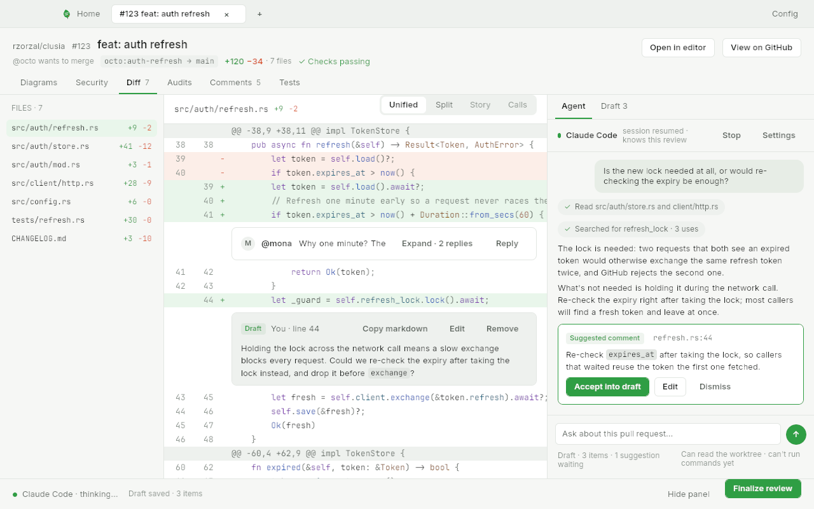</p>

<p align="center"></p>

<p align="center">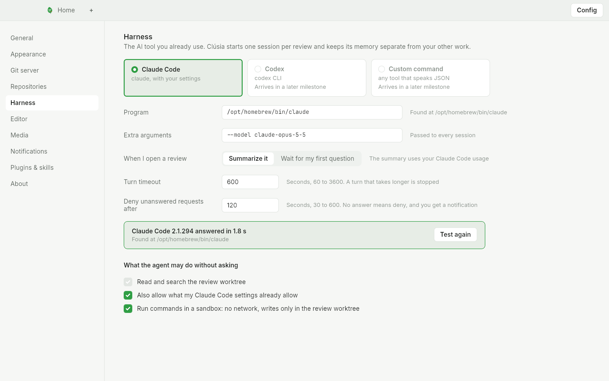</p>

<p align="center">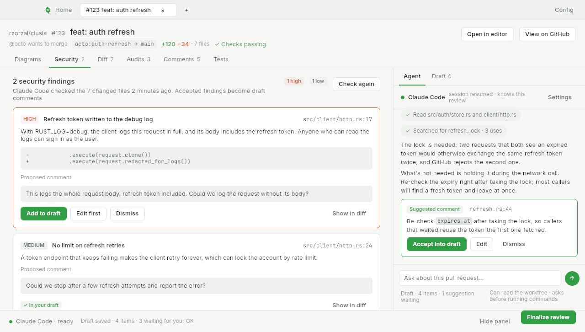</p>

<p align="center">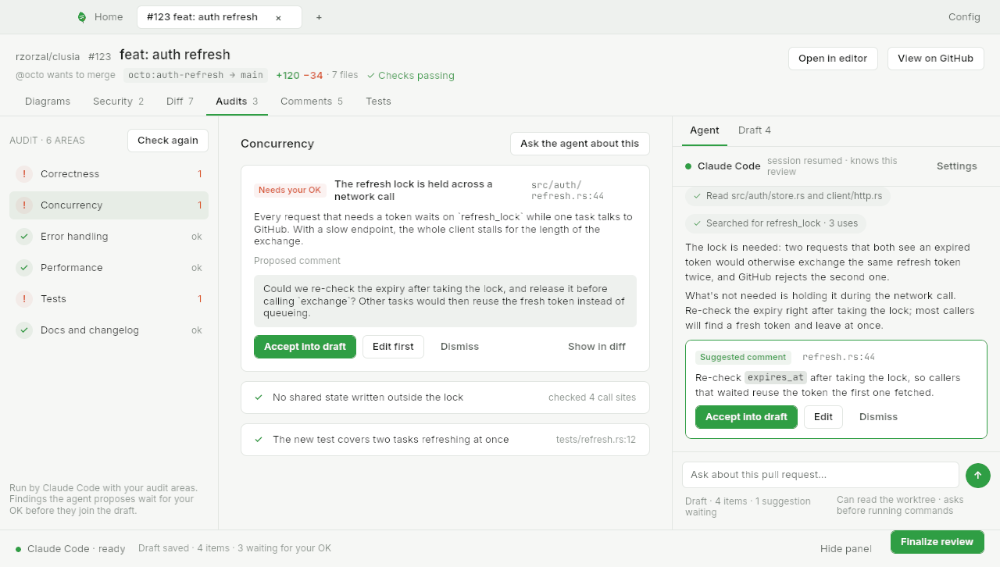</p>

<p align="center">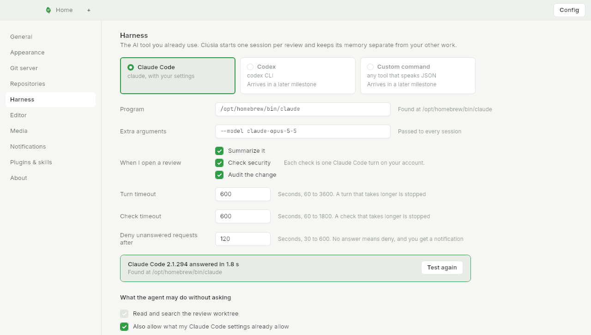</p>

<p align="center">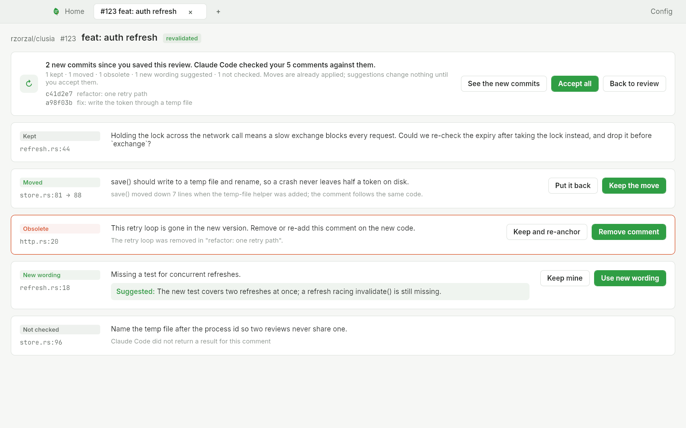</p>

<p align="center">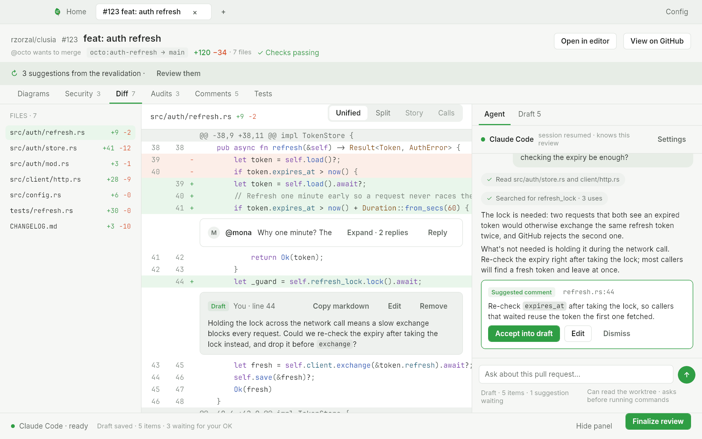</p>

<p align="center">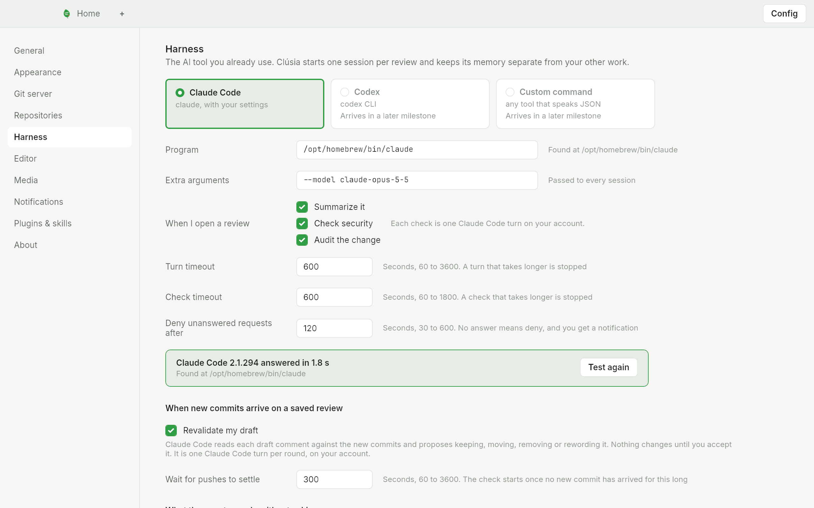</p>

<p align="center">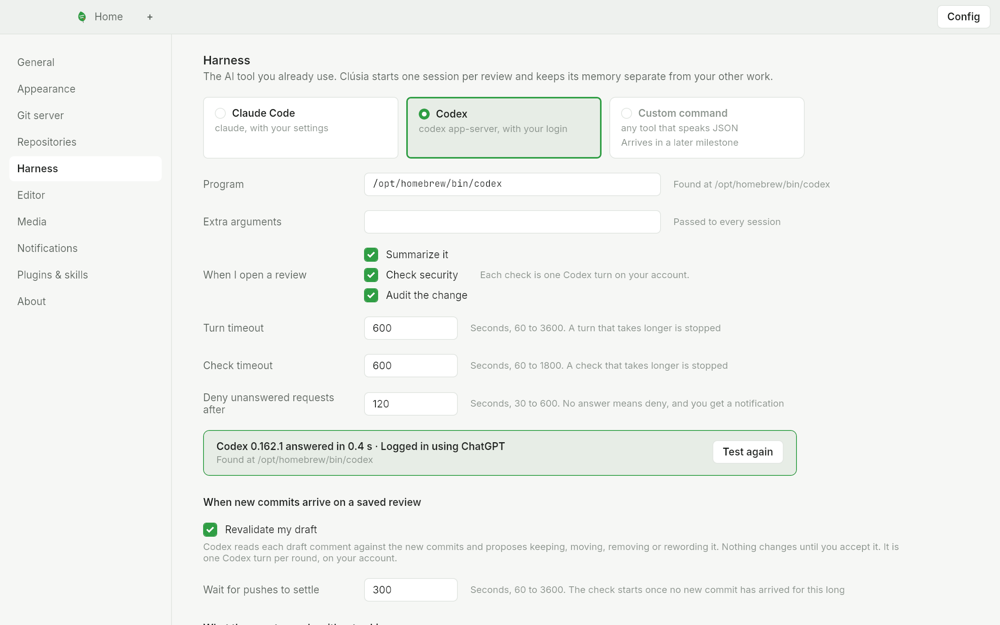</p>

<p align="center">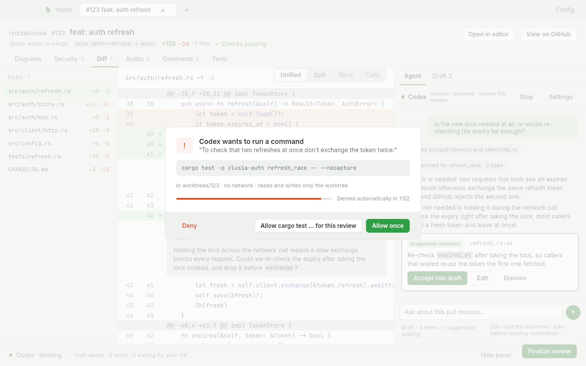</p>

<p align="center">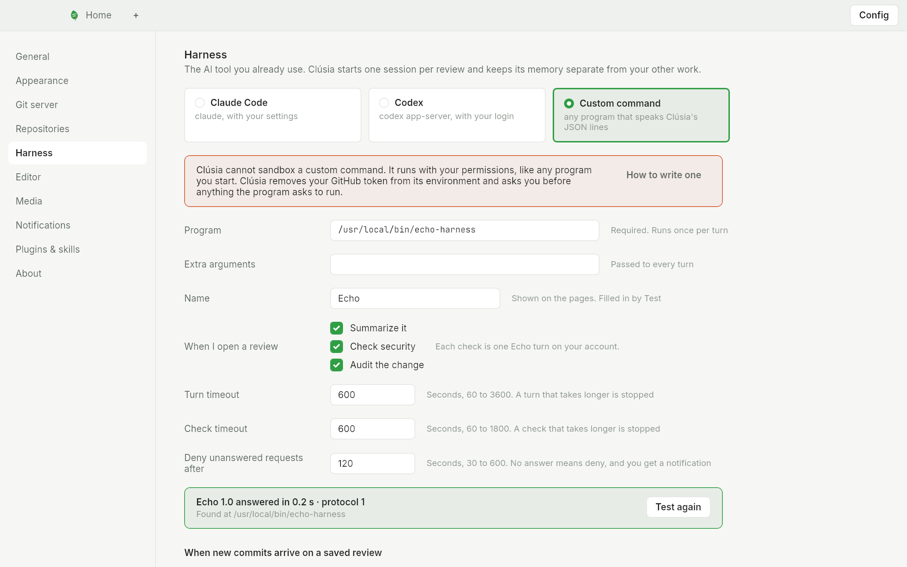</p>

<p align="center">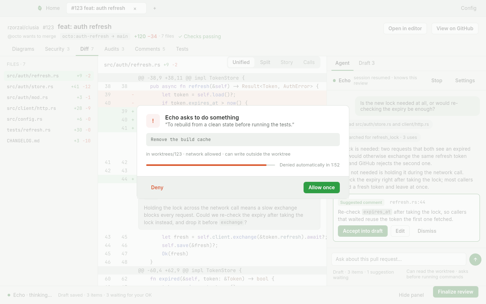</p>

<p align="center">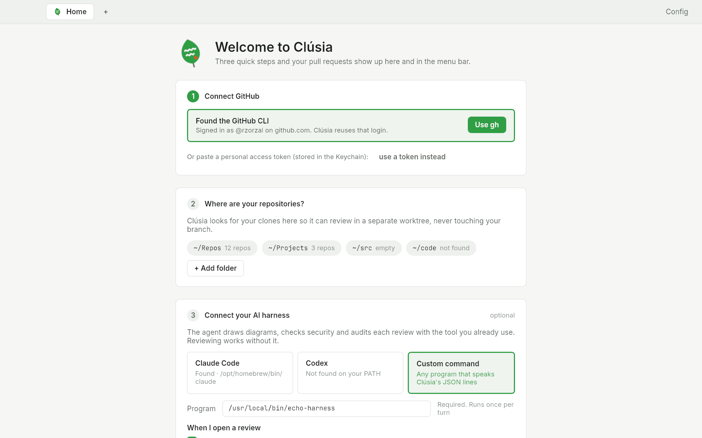</p>

## Tests

- **What it does.** It runs the pull request's own tests on your Mac, isolated: all of them, the ones near the change (in a file the PR touches, in the module of a changed function, or named by the agent), or one. Nothing runs when a review opens. `clusia tests owner/repo#123 --generate` probes the machine (no agent) and asks your agent, in one forked read-only turn, for a recipe; Clúsia writes it from the agent's answer to `.clusia/recipe.toml` in the worktree. The file is never committed.
- **The Tests tab.** A review's **Tests** tab starts empty with **Generate tests** and runs nothing on its own: the click is the one agent turn on your account that writes the recipe (a read-only fork of the review's session). The tab then shows the setup plan to approve (see below) and, once the setup is done, **Auto Tests**: the **Environment** (where tests run, the image or toolchain, what is reused, the services, who wrote the recipe and whether you approved it), the **Last run** (passed, failed and skipped, how long, where it ran, how many tests the repository has and how many are near the change), and the **Run the tests** card (**Run tests near this change**, **Run all tests**, **Stop**). Click ▶ on a row to run only that test. The list shows failed tests first, then passed, then skipped, with the filters **All**, **Failed** and **Near this change**; a failure's detail shows the command and the test's own output, with **Run again**, **Open in editor**, **Full log** and **Comment on this line** (a comment on a line the pull request changed goes to the draft on that line; any other goes to the draft as a general note). **Checks on GitHub** lists GitHub's checks by name with a mark for each. The tab's badge is `●` while something runs and the number of failed tests of the latest run otherwise. A run of an older commit shows **Stale**, never as the latest, and the tab asks again when the pull request gets a new commit. **Run Function tests** (one changed function at a time, with cases the agent writes) comes with the next milestone. Everything the pull request, its agent or its tooling wrote (test names, output, step titles and commands, check names) is drawn as plain text: it is never a link and never acts when clicked.
- **The setup plan.** When the recipe is written, a modal opens once with every step: its title, its exact command, where it runs (`container`, `sandbox` or an amber `host` row for what runs on your Mac) and a `network` tag when it uses the network, then the test commands (`All`, `One test`, `List`) and the variables, which are fake values you can edit in the recipe. Each step has a checkbox, checked by default. **Approve selected** approves exactly the steps you checked and the test commands; **Approve all and set up** approves every step the modal shows, never a step you have not seen; **Edit recipe** opens the file in your editor. If the recipe changes while the modal is open, the modal shows the new plan and approves nothing until you look at it again. A recipe you edited shows as "Recipe edited by you", and a new proposal from the agent waits behind a banner until you click **Accept**.
- **Config › Tests.** **Where tests run** is `auto`, `container` or `local`; the engine Clúsia found (name, socket, running or stopped) with **Check again**; the limits per run (CPUs, memory, how long before a run is stopped, how many runs at once); and the **disk used by test environments** (images, caches, worktree outputs) with **Clean up…**, which asks first and removes only what Clúsia made.
- **Two runners.**
  - **Container**, when a Docker-compatible engine is installed: Colima, OrbStack, Docker Desktop or Podman, found even with launchd's thin `PATH`. Each run is a new `docker run --rm` with `--network none` (or the stack's internal network when the recipe has services), the worktree at `/work`, the clone's git folder read-only, cache volumes per repository and ecosystem, the CPU and memory limits of Config › Tests, and no variable from your environment.
  - **Local sandbox**, when there is no engine: Clúsia's own `sandbox-exec` profile. It has no network, and it writes only to the worktree, a temp folder per review and a cache folder per repository. It cannot read `~/.ssh`, `~/.aws`, `~/.config/gh`, `~/.netrc`, `~/.docker/config.json`, `~/.kube`, `~/.gnupg`, `~/Library/Keychains`, `~/.git-credentials`, `~/.config/git/credentials`, `~/.cargo/credentials` and `credentials.toml`, `~/.pypirc`, `~/.config/gcloud`, `~/.azure`, `~/.claude`, `~/.claude.json`, `~/.codex`, `~/.npmrc`, `~/.yarnrc.yml`, `~/.gem/credentials`, `~/.m2/settings.xml`, `~/.gradle/gradle.properties`, `~/.terraform.d/credentials.tfrc.json`, `~/.vault-token`, Clúsia's data folder or the clone's `.env*` files. A run starts from an empty environment, so no token reaches it. It can signal only its own processes.
  - `tests.runner` picks one (`auto`, `container`, `local`).
- **You approve first.** Anything that needs the network or changes state is a step in the setup plan: starting a stopped engine, pulling or building the image, `npm ci` and the like, the compose services the tests need. Each step shows its exact command, where it runs (amber, "on your Mac", for host steps) and whether it uses the network. The recipe's test commands are shown and approved too. Nothing from the recipe runs before that, not even the command that lists the tests. An approval belongs to the review and the recipe's exact contents: a recipe changed by you, the agent or the pull request asks again. A pull request that ships its own `.clusia/` folder is refused.
- **Your recipe stays yours.** Edit `.clusia/recipe.toml` as you like. Clúsia overwrites only what it wrote itself, and a new proposal from the agent waits until you accept it.
- **Services.** When the recipe names compose services, Clúsia starts its own copy under its own project, with no host folders, no published ports and an internal network. It never uses the stack you have running, and takes its copy down when you close, publish or discard the review, and when the daemon stops.
- **Disk.** Images are tagged `clusia/<repo>:<hash>` and reused while the recipe's image inputs hold. Images and cache volumes go when the last worktree of the repository goes; containers are `--rm`, and the 6-hour sweep removes any orphan `clusia-*` container. Clúsia removes only what it labelled, never a base image you pulled. The last 5 runs per commit (20 in all) and their logs (10 MB each at most) are kept, and go when the review is published or discarded. Runs on an older commit show as *Stale*.
- **Never.** Clúsia never installs an engine or a toolchain, never copies an `.env` file (the recipe lists fake values you can edit), never connects the tests to your own running services, and never runs anything you did not approve. A setup step in the local sandbox does not see your `~/.npmrc`, so a private registry needs a container engine or a project-level `.npmrc` without the token.
- **GitHub's checks** appear by name next to the local runs.
- **The limits.** A test run executes the pull request's own code. The container and the sandbox are what keep it in. The local sandbox relies on `sandbox-exec`, which Apple deprecated but which still works; if it stops working, the local runner refuses and asks for an engine. What else to know:
  - the dependency caches of a repository (its cache folder and volumes) are shared by every pull request of that repository, so one pull request can leave something in them that a later run uses;
  - a recipe's `runner = "local"` picks the sandbox even when an engine is installed; the setup plan shows the runner, and the approval covers it;
  - in the local sandbox, a process that calls `setsid` leaves the run's process group, so Stop, the timeout and closing the review do not end it; it keeps the sandbox's limits;
  - a setup step that has the network uses Docker's bridge network, which can reach your local network, as Docker's networking allows;
  - Go test names carry no package, so two packages with a test of the same name are listed once.

## Notifications and login

Clúsia notifies you when:

- you are asked to review a pull request;
- new commits arrive on a pull request you reviewed;
- someone replies in a thread you started or joined;
- someone mentions you;
- CI fails on a pull request you opened;
- syncing with GitHub has a problem (an expired token, no connection for more than 10 minutes, a rate limit);
- a damaged settings or state file was set aside.

In Config › Notifications each event has its own switches for the tray list, macOS banners and sound. There are four soft bundled sounds (with a preview), **Do not disturb** hours and weekdays, *Follow macOS Focus*, *Group bursts* (updates to one pull request within 2 minutes become one banner), and a button that sends a test notification. Do not disturb silences banners and sound, never the tray list.

Config › General has **Start at login**. **Quit** in the tray stops everything (tray, window and daemon) until you open Clusia.app again.

<p align="center">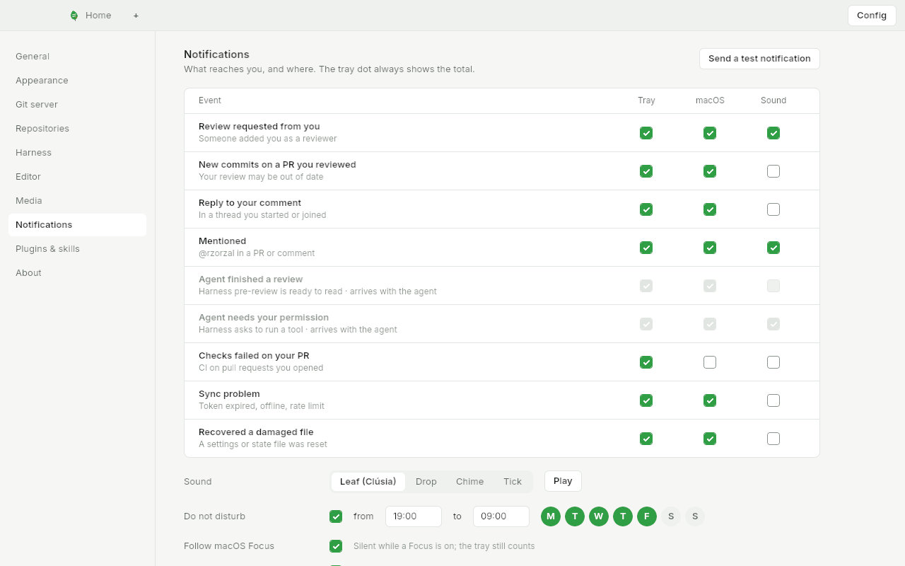</p>

## Where things live

| What | Where |
|---|---|
| The app | `/Applications/Clusia.app` (or `~/Applications`) |
| The `clusia` command | a link in `/usr/local/bin` (or `~/.local/bin`) |
| Reviews and settings | `~/Library/Application Support/Clusia` |
| Logs | `~/Library/Logs/Clusia/daemon.log`, `app.log`, `tray.log`, and `daemon.launchd.log` for what the login agent printed |
| The agent's chat logs | `~/Library/Application Support/Clusia/agent/` (one `.jsonl` log and one `.state.json` per review); the agent reads `.clusia/review.md` in each worktree |
| Test records and logs | `~/Library/Application Support/Clusia/tests/` (one `.json` per review, `logs/`, `tmp/`, `cache/`); the recipe is `.clusia/recipe.toml` in each worktree |
| The login agent | `~/Library/LaunchAgents/io.github.rzorzal.clusia.daemon.plist` |

[`docs/daemon.md`](docs/daemon.md) has the environment variables, files and log rotation.

**Privacy:** your GitHub token comes from `gh` or the macOS Keychain and never appears in logs or output. Clúsia talks to GitHub and, if you add a key, to Giphy, and to nothing else (the agent is your own Claude Code, which talks to Anthropic under your account). Your own clone is never checked out or branched: Clúsia only adds refs under `refs/clusia/` and works in separate worktrees.

## Troubleshooting

**No notifications.** Check System Settings › Notifications › Clúsia. Config › Notifications shows the permission Clúsia sees and can send a test.

**`clusia: command not found`.** The link went to `~/.local/bin` and that folder is not on your `PATH`. Add `export PATH="$HOME/.local/bin:$PATH"` to your shell profile.

**The tray is gone after a crash.** Open Clusia.app again. launchd restarts the daemon by itself after a crash.

**The agent says "Install Claude Code or set its path".** Config › Harness › Program: leave it empty to look on your `PATH`, or give the full path of `claude`, then press **Test**.

**The agent says "Run `claude` once in a terminal".** Claude Code is not signed in. Run `claude` in a terminal and sign in, then ask again.

**The agent says a command was denied: "no answer in time".** Nobody answered the permission request within the time in Config › Harness › *Deny unanswered requests after* (2 minutes by default). Ask again, and answer in the window, from the notification or at the terminal. Check System Settings › Notifications › Clúsia if no notification came.

**A command fails with no network.** The sandbox is on: commands run with no network and can only write in the review's worktree. Turn it off in Config › Harness (*Run commands in a sandbox*) if you really need it, and read the modal's last line before you allow anything.

**A check says "Waiting for another check".** Two checks run at once across all your reviews; this one starts when a place is free. **Stop** on a running check frees it.

**A check failed or ran out of time.** The tab shows why and **Try again**. A check stops after the time in Config › Harness › *Check timeout* (10 minutes by default). It never changes your draft by itself.

**The Security tab says "Checked an older commit".** The pull request got a new commit after the check. Press **Check again**; with *Check security* on in Config › Harness it also runs again when you reopen the review.

**A saved review was not revalidated.** It needs *Revalidate my draft* on in Config › Harness, a program Clúsia can find, and a pull request that is still open. The run starts after the wait for pushes to settle (5 minutes by default; every new push restarts it) or when you open the review. The review's screen says *Waiting for pushes to settle* with **Revalidate now**, or why it failed with **Try again**.

**The revalidation says "This comment changed since the suggestion".** You edited, moved or removed that comment after the agent made its proposal, so the proposal no longer fits it. Run **Revalidate now** to get a new one; nothing was applied.

**Put it back is disabled.** The line the comment was on before this round is not in the pull request's diff any more, and GitHub would refuse a comment there. Keep the move, or **Keep and re-anchor** on a line of the diff.

**Hooks do not run in the agent's chat.** On purpose: your Claude Code hooks (notifiers, sounds) are off for turns Clúsia starts in the background.

**Something looks wrong.** Read the logs in `~/Library/Logs/Clusia`, starting with `daemon.log`.

**Stop everything.** Choose Quit in the tray, or run `clusia daemon stop`.

**Start fresh.** Run `clusia uninstall`, move `~/Library/Application Support/Clusia` to the Trash, and install again. This deletes your saved drafts and settings.

**`clusia tests` says the engine is stopped.** The environment line names the start command (`colima start`, open OrbStack or Docker Desktop, `podman machine start`). Run it yourself, or approve the **engine** step in `--setup`.

**The setup says "<Engine> can't see <path>".** Your engine's VM does not share that folder. Share it (Colima: `mounts` in `colima.yaml`) and run `--setup` again.

## Uninstall

```sh
clusia uninstall
brew uninstall clusia    # only if you installed through Homebrew
```

`clusia uninstall` removes the app, the login agent and the `clusia` link. Your reviews and settings stay in `~/Library/Application Support/Clusia` until you delete that folder.

Builds from before the ad hoc signing may have left a signing identity in your login keychain. Remove it with:

```sh
security delete-identity -c "Clúsia Local"
```

## The name and the mark

*Clusia* is a genus of tropical American plants, named after the 16th-century botanist Carolus Clusius, who was known for describing plants with great care. In Brazil, *Clusia fluminensis* grows on the restinga, the sandy coast where salt, wind and strong sun leave little else standing. It manages with thick, waxy leaves and with a kind of photosynthesis that takes in air at night to save water.

One of its relatives, *Clusia rosea*, is known as the **autograph tree**: whatever you write on its leaves stays there, without harming the plant. That is what a good review does. It leaves a clear, lasting note on someone else's work and makes it stronger.

The mark is that leaf. The two written lines are review comments, and the orange point is the one thing that still needs attention. The colors carry the same meaning in the app: green for additions and approval, orange for removals and risk.

<p align="center">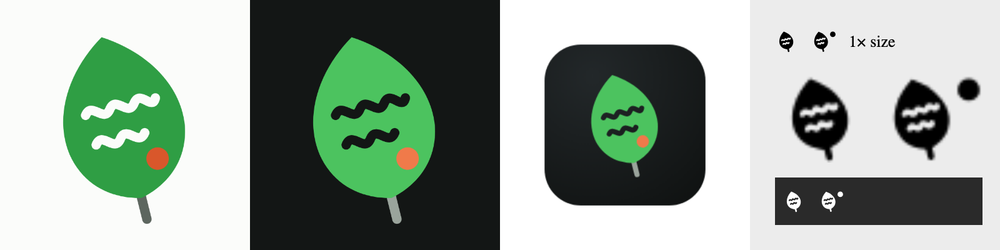</p>

Brand files (SVG, menu bar templates at 1× and 2×, app icon `.icns`) live in [`docs/assets/brand`](docs/assets/brand). The accent colors are green `#2F9E44` / `#4CC35F` and orange `#D9572B` / `#F07A4A` (light / dark surfaces).

## How it is built

Clúsia is a Rust workspace with four programs that talk over a local Unix socket:

| Program | What it does |
|---|---|
| `clusiad` | The background service. It syncs with GitHub, manages worktrees, keeps review drafts and publishes reviews. It is the only part that holds state or secrets. |
| `clusia-tray` | The menu bar icon and popover (native AppKit). It is the app you open (Clusia.app), the only part that posts notifications, and it keeps the daemon running. |
| `clusia-app` | The main window (Bevy): Home, Config and the review screen (diff in Unified or Split with syntax colors, rich-text comments with one composer: formatting, emoji, Giphy GIFs, image links and a preview; finalize), plus a first run for a new machine. Opening it starts the daemon if needed, and a second launch brings the open window forward. |
| `clusia` | The command-line interface. |

## Development

Every change passes the same gate:

```sh
cargo fmt --all --check && cargo clippy --workspace --all-targets -- -D warnings && cargo test --workspace
```

Tests never call the real GitHub, the real `gh` or the real Keychain. Other scripts in `scripts/`:

- `m6-check.sh`: the owner check for install, launch and notifications, run on a real Mac with someone at the keyboard (it stops the daemon and the tray);
- `sp2-m1-check.sh --pr owner/repo#N`: the owner check for the agent chat, run on a real pull request with your own Claude Code (it asks first, spends a little of your usage and publishes nothing);
- `sp2-m2-check.sh --pr owner/repo#N`: the owner check for agent permissions, run on a real pull request with your own Claude Code (it asks first, changes three settings and puts them back, makes you answer every request yourself and publishes nothing);
- `sp3-m3-check.sh --pr owner/repo#N`: the owner check for the Story and Calls views, run on a pull request of yours (Rust, TypeScript and Python files) with your own agent (it asks first, spends one turn to write the story and one to rewrite it, changes six settings and puts them back, makes you answer every request yourself, makes you push one small commit, and publishes nothing);
- `sp3-m2-check.sh --pr owner/repo#N`: the owner check for the 3D keyword view, run on a pull request of yours with your own agent (it asks first, spends a plan turn, one turn per diagram and the two keyword turns, changes five settings and puts them back, makes you answer every request yourself, and publishes and pushes nothing);
- `sp3-m1-check.sh --pr owner/repo#N`: the owner check for the diagrams of a change, run on a pull request of yours with your own agent (it asks first, spends a plan turn and one turn per diagram, changes four settings and puts them back, makes you answer every request yourself, makes you push the one commit it needs, and publishes nothing);
- `sp4-m1a-check.sh rzorzal/repo#N`: the owner check for the tests from the command line, run on a pull request of yours with your own agent (it asks first, spends one turn for the recipe, runs the tests in a container or Clúsia's sandbox, changes `tests.runner` for one step and puts it back, makes you answer the setup question yourself, and publishes nothing);
- `sp4-m1b-check.sh [rzorzal/blog#37]`: the owner check for the Tests tab and Config › Tests, run on a pull request of yours with your own agent (it asks first, makes you do every click yourself, approve every step yourself and run every test yourself, reads what the daemon says and compares it with the window, changes no setting, and publishes nothing);
- `flake-hunt.sh [RUNS]`: runs the suites that talk to a daemon over and over and names the tests that failed;
- `leak-check.sh`: runs the whole suite and fails if it leaves a `clusiad` running on a temporary home.

The window runs on demo data, with no daemon and nothing saved, with `target/debug/clusia-app --demo --dark`. Plans and specs live in the GitHub issues: the design spec is [#2](https://github.com/rzorzal/clusia/issues/2).

## Credits

Emoji graphics from [Twemoji](https://github.com/jdecked/twemoji), © Twitter, Inc. and other contributors, licensed under [CC-BY 4.0](https://creativecommons.org/licenses/by/4.0/). Resized for use in Clúsia. Emoji names and shortcodes from [emojibase](https://github.com/milesj/emojibase) (MIT). Fonts: Inter and JetBrains Mono (SIL OFL 1.1). GIF search is powered by [GIPHY](https://giphy.com/). The licences and links are also under Config › About.

## License

[Apache-2.0](LICENSE)
