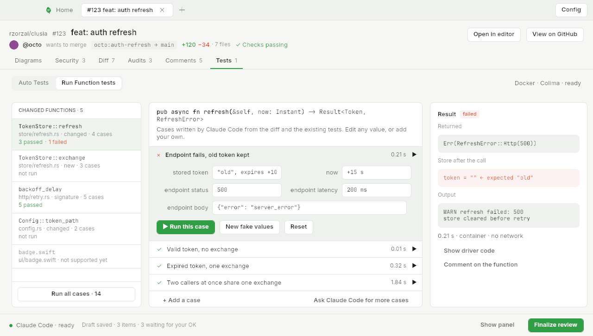
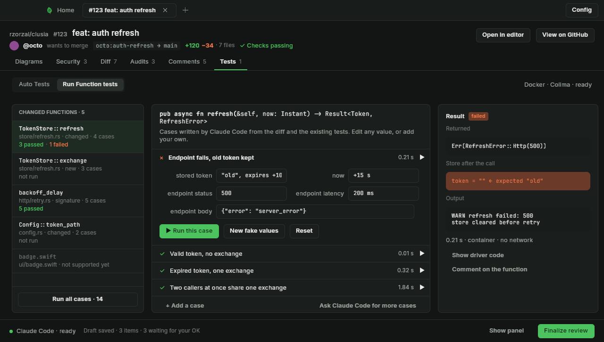
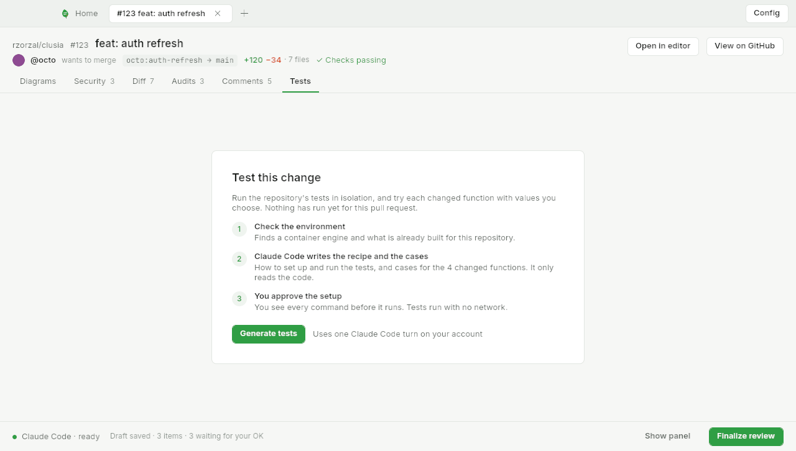
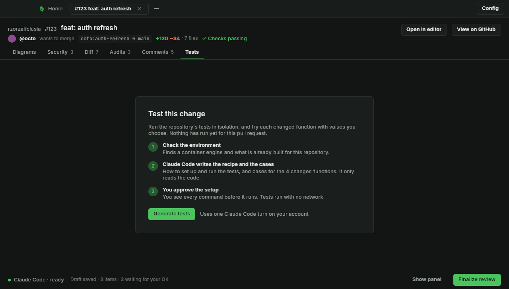
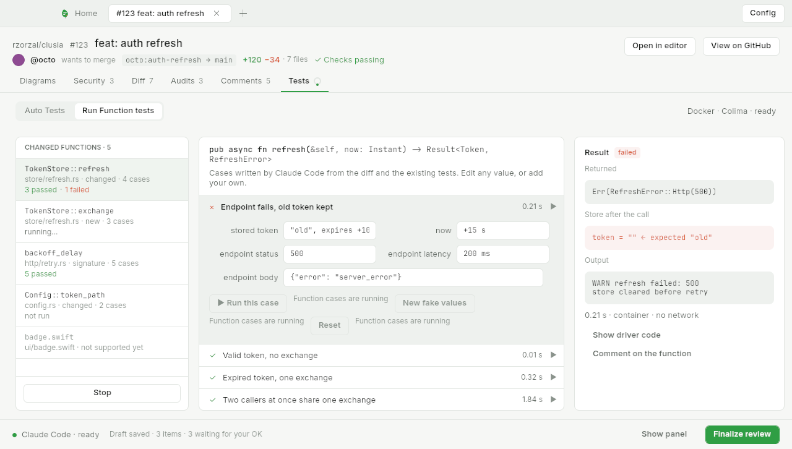
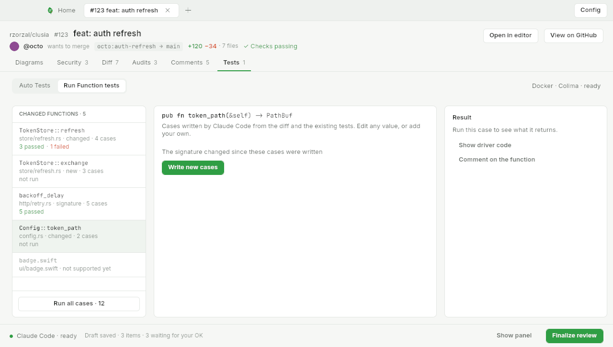
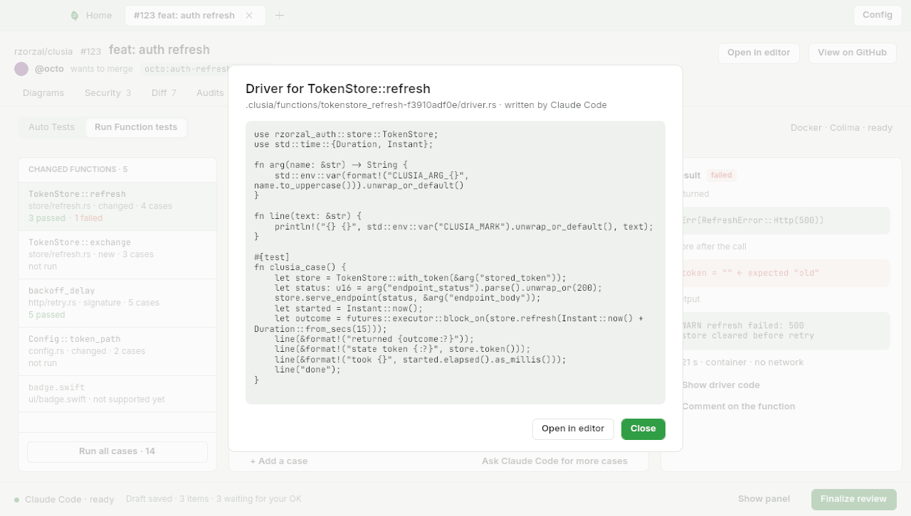

# Run Function tests: renders against the mockups

Renders come from `cargo test -p clusia-app --test screenshot -- --ignored` (`CLUSIA_SCREENSHOT_ONLY` names
the scenes). The window renders at 1280×726; the mockups are 1280×800 with macOS window chrome, so
the height, the traffic lights, the title bar and the header rows differ in every scene and are not repeated below.
The mockups were drawn with the system font; the renders use the app's bundled fonts, so glyph widths differ slightly.

## tests-functions (`Tests-functions.png`, `Dark-Tests-functions.png`)

Same regions, order, copy, states, pills, the green selected row and the orange blocks. Differences:

- The Swift file's row reads `badge.swift` over `ui/badge.swift · not supported yet`; the mockup names a function (`render_badge`). Clúsia does not read Swift functions, so the row is the file.
- The signature wraps onto a second line (`RefreshError>`); the mockup's fits on one. The bundled font is wider than the mockup's system font, and the signature is shown in full rather than cut.
- The fields (a pair wraps its field under its label, and a row wraps its second pair, when the column is narrower than they are): two label-and-field pairs per row and a `json` value on its own row, as the mockup. The mockup's *stored token* field wraps `"old", expires +10 s` inside the field; the app keeps it on one line and clips it (`+10`), because a field never grows its row.
- The Output of the failed case shows the mockup's two lines; a real `cargo test` prints more (compiler lines), which the Output box scrolls.
- The Returned and state blocks take their fills from the theme's `OrangeSoft`/`Chrome` tokens, not the mockup's hex values (in dark the failed block is a stronger orange).
- **Show driver code** and **Comment on the function** are ghost buttons, not underlined links, and **Ask Claude Code for more cases** is one too. The `+` of **+ Add a case** is an ASCII plus.
- The mockup shows "Claude Code · session active · Draft saved · 4 items" in the footer; the app's footer is the shared review footer ("Claude Code · ready · Draft saved · 3 items · 3 waiting for your OK"). It is the same on every review screen.
- The header shows the pull request's branch, change counts and checks (the shared review header); the mockup abbreviates it. The Tests tab carries a badge (`1`, the failed case count) that the mockup lacks.
- The sub-tab bar's chips and the **Docker · Colima · ready** text sit slightly lower than the mockup because of the header's second row.

## tests-empty (`Tests-empty.png`, `Dark-Tests-empty.png`)

- Step 1 reads "Finds a container engine and what is already built for this repository." The mockup says "Finds Docker (here: Colima, running) …": the empty scene's engine probe has not answered when the card draws, so it names no engine.
- Step 2 reads "cases for the 4 changed functions"; the mockup says 5. The functions view is not loaded in this scene, so the count is the Tests view's own, and it leaves the unsupported Swift file out.
- **Generate tests** is a smaller button than the mockup's.

## tests-functions-running (no mockup)

The Mockup's data with a run at 6 of 14 and `TokenStore::exchange` current: `running…` in the list, a spinner on the Tests tab, and **Stop** where **Run all cases** was. The three edit buttons and **Reset** go off with a reason; each prints "Function cases are running" next to it, which makes the button row wrap onto two lines. **+ Add a case** and **Ask … for more cases** are greyed buttons. Left as is: the reason is the point of the disabled state.

## tests-functions-stale (no mockup)

`Config::token_path` is selected: the signature, the note "The signature changed since these cases were written" and **Write new cases**, no cases and no **Run this case**. The list's `Run all cases · 12` leaves this function's cases out. The Result column still says "Run this case to see what it returns." though no case can run here; it only fills the column.

## tests-functions-driver (no mockup)

The driver modal over the Mockup state: the title "Driver for TokenStore::refresh", the path of the driver and who wrote it, the Rust driver as plain monospace text in a grey box (no links, no highlighting), then **Open in editor** and the green **Close**. A line longer than the box wraps to the left edge with no indent (`Duration::from_secs(15)));`). The page behind is dimmed and not interactive.
